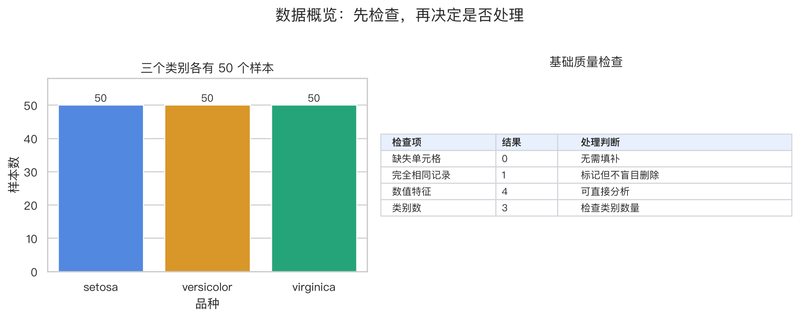
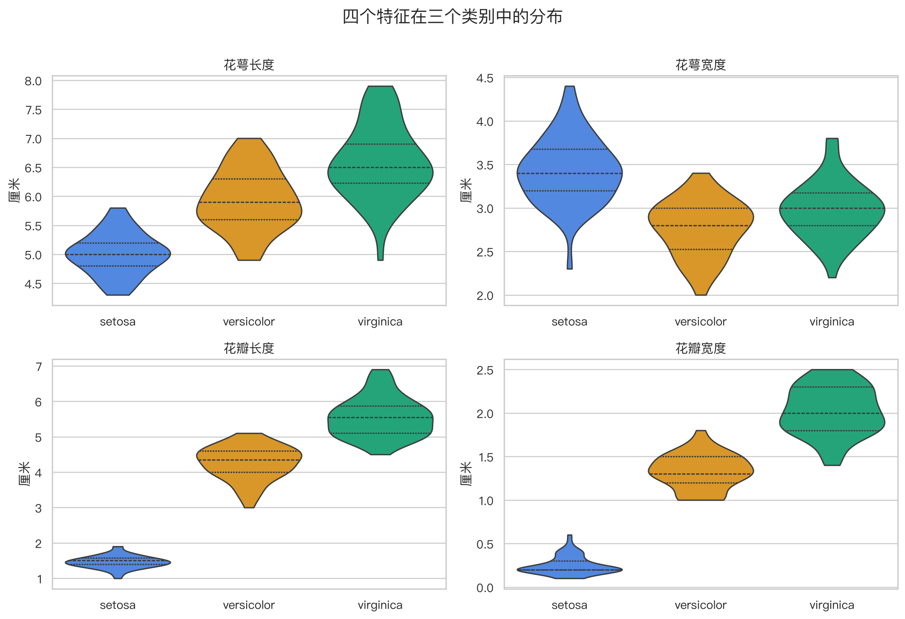
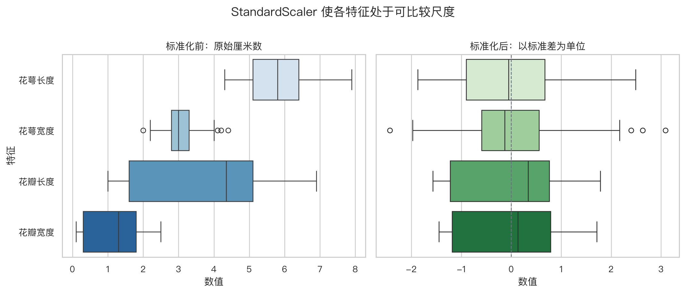
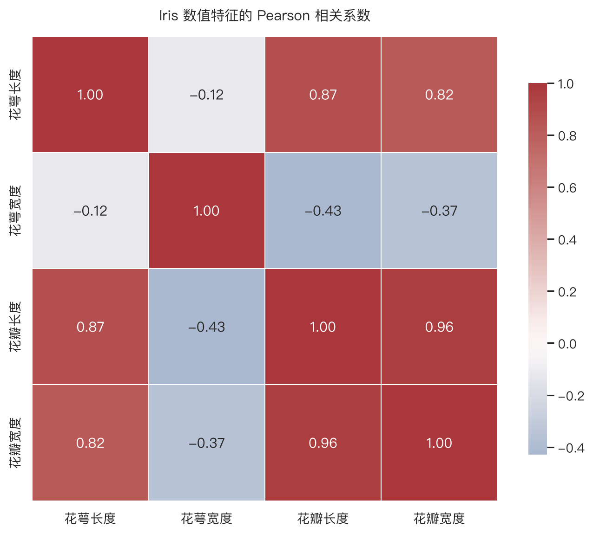
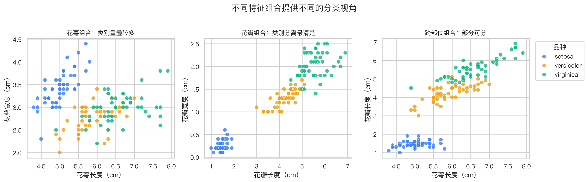
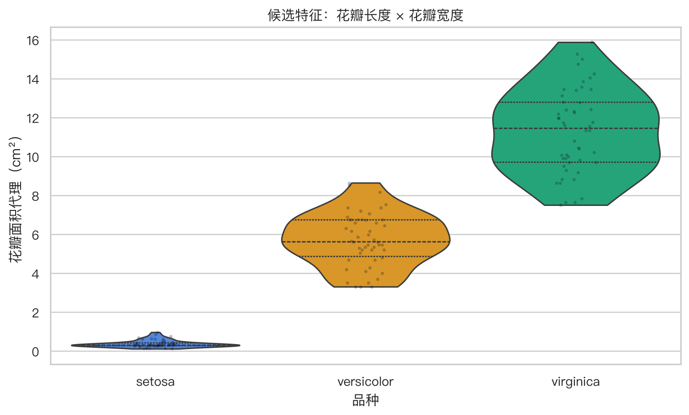

<!--# irisdata -->
# Iris 数据分析实验

本实验对应 [数据与特征](node:features)，用同一份 Iris 数据把概念章节中的判断变成可运行、可检查的证据。Notebook 不训练分类器，重点是先回答“数据长什么样、有哪些质量问题、哪些特征值得后续建模”。

## 阅读与运行

- [实验报告 HTML](../../实验/reports/01_iris_data_analysis.html)：浏览器直接阅读代码、输出、观察和结论。
- [Notebook 源码](../../实验/notebooks/01_iris_data_analysis.ipynb)：在 JupyterLab 或 VS Code 中重新运行。
- [实验说明](../../实验/README.md)：环境、运行方式与实验规范。

直接用浏览器打开 `.ipynb` 只会看到 JSON 文本，因为 Notebook 是结构化源文件，不是网页。项目因此同时提交可执行的 `.ipynb` 和静态 `.html` 报告；GitHub 也能直接渲染 Notebook。

## 实验问题

| 步骤 | 要回答的问题 | 证据 |
|---|---|---|
| 数据结构与质量 | 样本、特征、标签分别是什么，是否缺失、重复或失衡 | 数据表与质量摘要 |
| 单变量分布 | 每个特征对三个类别的区分程度如何 | 分组小提琴图 |
| 尺度比较 | 原始量纲差异怎样影响可比性 | 标准化前后箱线图与手算核对 |
| 变量关系 | 哪些特征重复表达信息，哪些二维组合更清楚 | 相关矩阵与三组成对散点 |
| 特征构造 | 新特征是否提供了更紧凑的观察视角 | 花瓣面积代理分布 |

## 关键观察

### 数据质量不是“全都正常”

Iris 没有缺失值，三个类别各 50 条，但存在一条数值完全相同的记录。数值相同不等于一定是重复采集，因此实验只标记、不盲目删除。这正是数据诊断与机械清洗的区别。

### 花瓣特征更能区分类别

四个特征都具有信息，但花瓣长度和花瓣宽度的类别分布分离更明显；花萼特征的重叠更多。后续二维决策边界优先使用花瓣特征，依据来自数据而不是经验猜测。

### 标准化改变尺度，不改变样本相对顺序

标准化后每个特征都围绕 0 波动，量纲差异不再直接主导距离和梯度。实验还用第一条记录核对了手算结果与 `StandardScaler` 输出。

### 相关性与可分性是两个不同问题

花瓣长度和花瓣宽度的相关系数约为 0.963，说明它们高度共同变化；同时，这两个特征构成的二维空间又最容易观察类别分离。高度相关不等于“其中一个一定无用”，还要结合模型和验证结果判断。

### 构造特征只是提出候选

花瓣长度乘花瓣宽度形成面积代理后，类别分布仍有明显差异；但它没有引入原始数据之外的新信息。后续必须通过交叉验证判断它是否真正改善模型。

## 本实验的边界

Iris 没有类别型输入和缺失值，因此本实验不演示 one-hot 编码和缺失值填补；也不在全数据上完成正式建模。数据划分、训练集拟合预处理器和 Pipeline 将在后续模型实验中完成。
