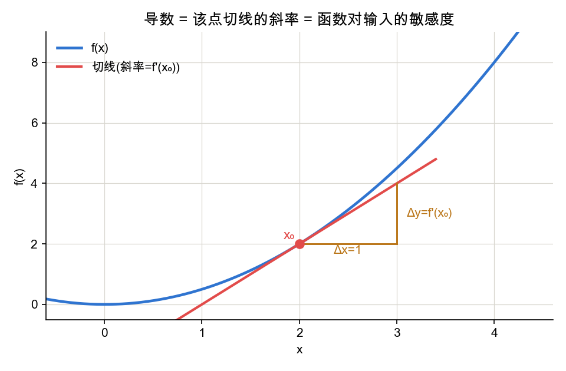
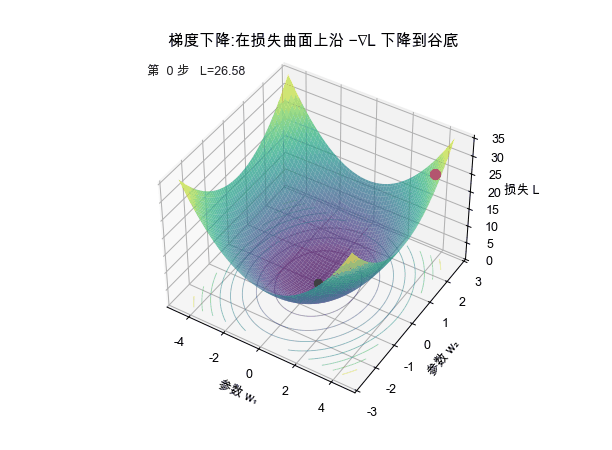
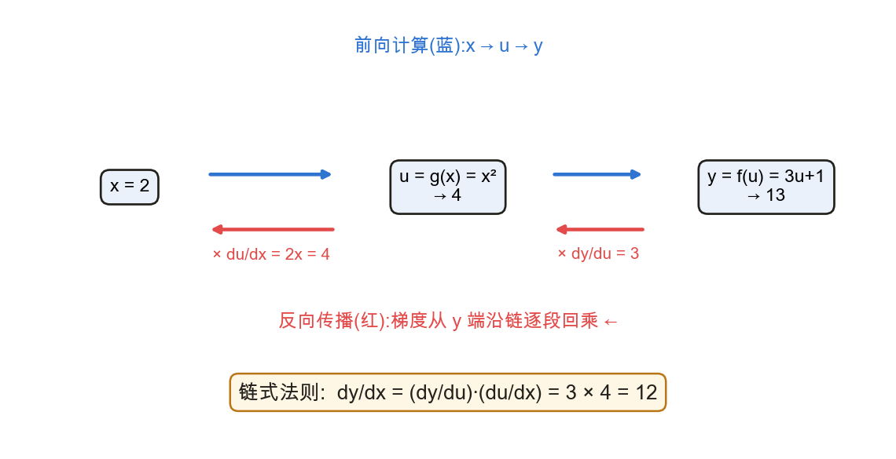
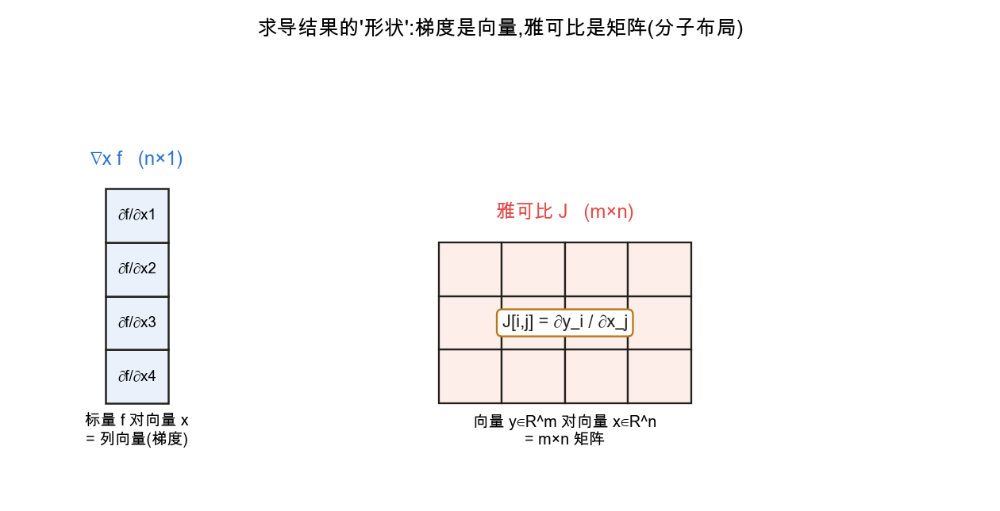

<!--# calc -->
# 微积分:导数、梯度与矩阵求导

> 训练神经网络的本质,是用**梯度下降**最小化损失函数。理解这一过程所需的微积分核心有三:**导数**刻画敏感度,**梯度**给出多维下降方向,**链式法则**把多层复合函数的梯度逐层传回。矩阵求导不是另一套数学,而是把这些规则写成向量 / 矩阵形状,让线性回归、神经网络层和反向传播都能批量计算。记号锚定 d2l 2.4 / 2.5。

## 1. 导数:函数对输入的瞬时变化率

📖 **权威详解**:[导数 · Wikipedia](https://zh.wikipedia.org/wiki/导数)

导数定义为差商的极限:
$$f'(x)=\lim_{h\to 0}\frac{f(x+h)-f(x)}{h}.$$
其几何意义是函数曲线在该点**切线的斜率**,刻画"输入发生微小变化时,输出变化的快慢与方向"——符号给出方向,绝对值给出敏感程度。

常用求导法则包括:
$$\frac{d}{dx}x^n=nx^{n-1},\qquad
\frac{d}{dx}e^x=e^x,\qquad
\frac{d}{dx}\ln x=\frac1x,$$
以及乘法与除法法则:
$$\frac{d}{dx}[fg]=f'g+fg',\qquad
\frac{d}{dx}\Big[\frac fg\Big]=\frac{f'g-fg'}{g^2}.$$
数值差商 $f'(x)\approx\dfrac{f(x+h)-f(x)}{h}$ 可以用于直觉验证,但不用于实际训练:若每个参数都靠扰动前后算一次,模型参数一多,前向计算次数会爆炸。

## 2. 偏导与梯度:多元函数的方向信息

📖 **权威详解**:[梯度 · Wikipedia](https://zh.wikipedia.org/wiki/梯度) ｜ [偏导数](https://zh.wikipedia.org/wiki/偏导数)

当函数依赖多个变量时,固定其余变量、仅对第 $i$ 个变量求导,得到**偏导数**:
$$\frac{\partial y}{\partial x_i}
=\lim_{h\to 0}\frac{f(x_1,\dots,x_i+h,\dots,x_n)-f(x_1,\dots,x_i,\dots,x_n)}{h}.$$

将全部偏导按分量排列,得到**梯度向量**:
$$\nabla_{\mathbf x}f(\mathbf x)=
\Big[\frac{\partial f}{\partial x_1},\frac{\partial f}{\partial x_2},\dots,\frac{\partial f}{\partial x_n}\Big]^\top.$$
梯度的关键性质是:$\nabla f$ 指向函数**上升最快**的方向,其反方向 $-\nabla f$ 指向下降最快的方向。

这正是**梯度下降**的依据——沿负梯度方向、以步长 $\eta$(学习率)迭代更新参数,损失随之下降:
$$\mathbf x\leftarrow\mathbf x-\eta\,\nabla f(\mathbf x).$$

完整数字计算例子见 [例子:Xw、均方误差与梯度下降](node:mathexample)。正文这里先保留一般公式,避免把具体样本数据误当作微积分本身。

## 3. 链式法则:反向传播的数学内核

📖 **权威详解**:[链式法则 · Wikipedia](https://zh.wikipedia.org/wiki/链式法则)

复合函数的求导法则。单变量情形,若 $y=f(u),\ u=g(x)$:
$$\frac{dy}{dx}=\frac{dy}{du}\cdot\frac{du}{dx}.$$
多变量情形,$y$ 经由中间变量 $u_1,\dots,u_m$ 依赖各 $x_i$:
$$\frac{\partial y}{\partial x_i}
=\sum_{j=1}^{m}\frac{\partial y}{\partial u_j}\frac{\partial u_j}{\partial x_i}.$$

神经网络是多层复合函数。**前向**逐层算出各中间量的数值;**反向**则把"损失对深层变量的导数"沿这条链**逐段回乘**——这构成了 [反向传播与计算图](node:backprop) 的数学基础。

如上图,$y$ 对 $x$ 的导数等于后一段局部导数 $\frac{dy}{du}$ 乘前一段 $\frac{du}{dx}$。把每个节点的"局部导数"按依赖关系乘起来,就得到端到端的梯度。

## 4. 矩阵求导:先看结果的形状

📖 **权威详解**:[矩阵微积分 · Wikipedia](https://zh.wikipedia.org/wiki/矩阵微积分) ｜ [雅可比矩阵](https://zh.wikipedia.org/wiki/雅可比矩阵)

矩阵求导最容易错的不是某个常数,而是**形状**与**布局约定**。本库统一采用:

- **梯度**使用分母布局:标量 $f$ 对向量 $\mathbf x\in\mathbb R^n$ 求导,结果与 $\mathbf x$ 同形,
$$\nabla_{\mathbf x}f=
\Big[\frac{\partial f}{\partial x_1},\dots,\frac{\partial f}{\partial x_n}\Big]^\top\in\mathbb R^n.$$
- **雅可比**使用分子布局:向量 $\mathbf y\in\mathbb R^m$ 对向量 $\mathbf x\in\mathbb R^n$ 求导,
$$J=\frac{\partial\mathbf y}{\partial\mathbf x}\in\mathbb R^{m\times n},\qquad
J_{ij}=\frac{\partial y_i}{\partial x_j}.$$
- 标量对矩阵 $W$ 求导,结果与 $W$ 同形:
$$\big(\nabla_W f\big)_{ij}=\frac{\partial f}{\partial W_{ij}}.$$

两种布局只差一个转置,但混用会让公式对不上。阅读论文或框架文档时,先确认作者采用哪种约定。

## 5. 深度学习常用矩阵求导恒等式

下面几条在线性回归、softmax 回归和反向传播里反复出现,以本库约定给出:

- $\nabla_{\mathbf x}(\mathbf a^\top\mathbf x)=\mathbf a$;
- $\nabla_{\mathbf x}\lVert\mathbf x\rVert^2=\nabla_{\mathbf x}(\mathbf x^\top\mathbf x)=2\mathbf x$;
- $\nabla_{\mathbf x}(\mathbf x^\top A\mathbf x)=(A+A^\top)\mathbf x$,当 $A$ 对称时 $=2A\mathbf x$;
- $\dfrac{\partial(A\mathbf x)}{\partial\mathbf x}=A$(雅可比);
- **最小二乘**:
$$f(\mathbf w)=\lVert X\mathbf w-\mathbf y\rVert^2
\quad\Rightarrow\quad
\nabla_{\mathbf w}f=2X^\top(X\mathbf w-\mathbf y).$$

若令最小二乘梯度为 0,可得到解析解:
$$\mathbf w=(X^\top X)^{-1}X^\top\mathbf y.$$
这条公式在 [线性代数](node:linalg#逆矩阵) 里从"求逆 / 伪逆"角度理解,在这里从"损失对参数求梯度"角度理解。

若损失写成均方误差(MSE, Mean Squared Error)的平均形式
$$L(\mathbf w)=\frac{1}{2n}\lVert X\mathbf w-\mathbf y\rVert^2,$$
则梯度为
$$\nabla_{\mathbf w}L=\frac1nX^\top(X\mathbf w-\mathbf y).$$
同一个公式的完整数字代入见 [例子:Xw、均方误差与梯度下降](node:mathexample)。

## 6. 链式法则的矩阵形式:反向传播的形状

多层网络 $\mathbf x\to\mathbf y\to\mathbf z$,标量损失对输入的梯度,可以写成雅可比连乘:
$$\nabla_{\mathbf x}\mathcal L
=\Big(\frac{\partial \mathbf y}{\partial \mathbf x}\Big)^\top
\Big(\frac{\partial \mathbf z}{\partial \mathbf y}\Big)^\top
\nabla_{\mathbf z}\mathcal L.$$

反向传播之所以高效,是因为它不是为每个参数单独重算整个网络,也通常不显式构造庞大的完整雅可比;它从损失端开始,每一步只拿"下游传回来的梯度"乘当前节点的局部导数,也就是 **vector-Jacobian product**。这就是链式法则在向量 / 矩阵计算图上的系统化应用。

## 应掌握的要点

- 导数的极限定义及其几何意义:切线斜率 / 敏感度;
- 梯度是偏导组成的向量,指向上升最快方向;梯度下降沿 $-\nabla f$ 更新参数;
- 链式法则解释反向传播:前向算值,反向回乘局部导数;
- 矩阵求导首先看形状:梯度与自变量同形,雅可比是输出维度 × 输入维度;
- 高频恒等式要能认出:$\nabla\lVert\mathbf x\rVert^2=2\mathbf x$、$\nabla(\mathbf x^\top A\mathbf x)=(A+A^\top)\mathbf x$、$\partial(A\mathbf x)/\partial\mathbf x=A$;
- 最小二乘梯度 $2X^\top(X\mathbf w-\mathbf y)$ 与平均均方误差(MSE)梯度 $\frac1nX^\top(X\mathbf w-\mathbf y)$ 是线性模型训练的核心公式;
- 反向传播 = 链式法则的向量化执行,实现上是从损失端回传的 vector-Jacobian product。

---
### 参考链接
- [d2l 2.4 微积分](https://zh.d2l.ai/chapter_preliminaries/calculus.html) · [d2l 2.5 自动微分](https://zh.d2l.ai/chapter_preliminaries/autograd.html)
- [The Matrix Cookbook (PDF)](https://www.math.uwaterloo.ca/~hwolkowi/matrixcookbook.pdf) — 矩阵求导恒等式速查
- [The Matrix Calculus You Need For Deep Learning](https://explained.ai/matrix-calculus/) — 面向深度学习的矩阵求导讲解
- [3Blue1Brown《微积分的本质》](https://www.3blue1brown.com/topics/calculus) — 几何直觉
