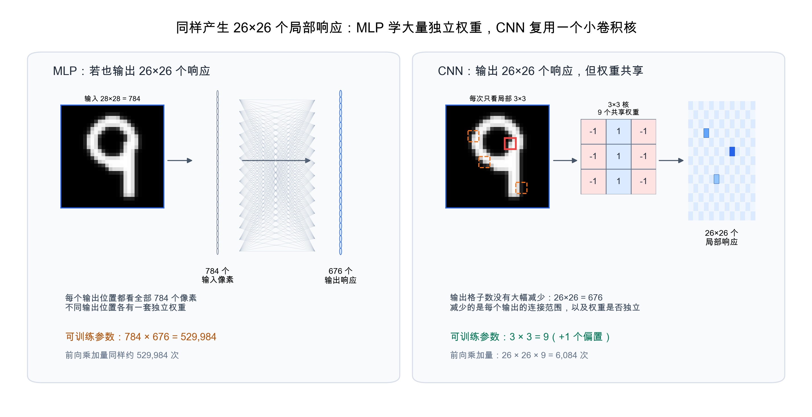

<!--# mlp2cnn -->
# 从 MLP 到 CNN

> [MLP](node:mlp) 已经解决了"如何用多层非线性函数学习复杂关系";CNN 进一步解决的是:**当输入是图片这种有空间结构的数据时,网络层应该怎样设计才更合理**。

## 1. 手写数字:MLP 的经典入门例子

手写数字识别是引入神经网络的经典例子。比如一张 $28\times28$ 的灰度图,可以展平成 $784$ 维向量,输入到 MLP:

$$
\text{image }(28\times28)\rightarrow \mathbf x\in\mathbb R^{784}\rightarrow \text{hidden layers}\rightarrow \mathbf p\in\mathbb R^{10}
$$

这类例子很适合第一次理解神经网络:每个像素是一个输入神经元,隐藏层尝试组合像素形成更高层特征,最后输出层给出 $0\sim9$ 的分类概率。3Blue1Brown 的神经网络入门也采用了这个路线:先用手写数字说明 $28\times28=784$ 个输入、隐藏层和 10 个输出类别。

## 2. MLP 也能学到笔画,问题是低效

容易误解的一点是:说 MLP 不适合图像,并不是说它完全学不到笔画、边缘、环形这类信息。对于 $28\times28$ 的小图,MLP 确实可以训练出能识别数字的模型;某些隐藏单元的权重重新摆成 $28\times28$ 后,也可能看起来像是在响应某些局部笔画。

但这是一种**从数据里硬学出来的规律**,而不是模型结构一开始就知道的规律。MLP 的全连接层有三个低效点:

- **展平没有删除信息,但没有显式利用相邻关系**:像素原本有上下左右邻接关系;展平成向量后,模型仍能通过权重学习这些关系,但结构上没有告诉它"相邻像素更相关"。
- **局部特征需要重复学习**:同一条竖笔画出现在左上、右上、下方,对 MLP 来说是不同位置上的不同输入连接,往往需要不同隐藏单元或不同权重模式分别学习。
- **参数量随图像尺寸快速膨胀**:一个隐藏单元若连接全部 $784$ 个输入,就有 $784$ 个权重;若输入是 $1000\times1000$ 图像,全连接层参数会立刻变得巨大。

所以更准确的说法是:MLP 可以处理图像,但它把"局部结构"和"同一特征可出现在不同位置"这些常识都交给训练去慢慢学,因此参数更多、数据需求更高、泛化也更吃力。

## 3. CNN 把图像先验写进网络结构

CNN 的核心动机,就是把上面的图像常识直接写进层的设计:

- **局部连接**:一个输出只看输入中的一小块区域,例如 $3\times3$ 像素;
- **参数共享**:同一个卷积核在整张图上滑动,用同一组权重检测同一种局部特征;
- **保留位置**:输出不是一个孤立神经元,而是一张特征图,记录"这个特征在什么位置出现"。

拿手写数字里的"竖笔画"举例。MLP 若想检测某个位置的竖笔画,一个隐藏单元通常要给 $784$ 个像素都配权重;如果竖笔画换到另一个位置,它还要再学一套位置相关的权重模式。

CNN 则用一个小卷积核表示"局部竖边缘 / 竖笔画"检测器。例如一个 $3\times3$ 核只需要 $9$ 个权重。它从图像左上角滑到右下角,每到一个位置只看附近 $3\times3$ 像素,计算一次局部加权和。若不加 padding、stride 为 1,一张 $28\times28$ 图经过一个 $3\times3$ 卷积核会得到 $26\times26$ 的特征图:

$$
28\times28 \xrightarrow{3\times3\ \text{kernel}} 26\times26
$$

这里要特别分清三种数量:

- **输出激活数**:从 $28\times28$ 到 $26\times26$,确实没有少很多;如果使用 padding,甚至可以保持 $28\times28$。第一层卷积的主要目标不是压缩图像,而是生成"局部模式在哪里出现"的响应图。
- **前向计算次数**:一个 $3\times3$ 核会在 $26\times26$ 个位置各算一次,所以乘加次数是 $26\times26\times9=6084$,不是只算 9 次。
- **可训练参数数**:这 $6084$ 次计算复用的是同一组 $3\times3$ 权重,所以可训练参数只有 $9$ 个(再加一个偏置)。这才是和全连接差异最大的地方。

这张特征图的每个位置都回答同一个问题:"这里附近像不像这个卷积核要找的局部模式?" 于是同一条小边缘无论出现在图像上方、左侧还是右下方,都可以由同一个卷积核检测出来。

## 4. 网络连接效果的具体对比

为了把对比说清楚,假设 MLP 和 CNN 都产生 $26\times26=676$ 个局部响应:

| | MLP 全连接层 | CNN 卷积层 |
|---|---|---|
| 输出激活数 | $676$ 个输出单元 | $26\times26=676$ 个特征图位置 |
| 每个输出看哪里 | 全部 $784$ 个像素 | 附近 $3\times3=9$ 个像素 |
| 可训练参数 | $784\times676=529984$ | $3\times3=9$(加 1 个偏置) |
| 前向乘加量 | 约 $529984$ 次 | $26\times26\times9=6084$ 次 |
| 参数是否共享 | 不共享;每个输出位置一套权重 | 共享;同一个核扫完整张图 |

所以你看到的没错:卷积层的输出格子数没有比输入少多少。CNN 这里真正减少的是**每个输出的连接范围**和**独立可训练参数数量**。

如果一层 CNN 有 $8$ 个 $3\times3$ 卷积核,灰度图输入通道为 1,参数量大约是:

$$
3\times3\times1\times8+8=80
$$

这里的 $+8$ 是每个卷积核一个偏置;输出激活数则是 $26\times26\times8=5408$。如果用全连接层也输出 $5408$ 个响应,仅权重就有:

$$
784\times5408=4239872
$$

如果 MLP 只设 $128$ 个隐藏单元,那参数是 $784\times128=100352$,但它输出的就不是一张保留位置的特征图,而是 128 个全局隐藏特征。两者比较的对象已经变了。

图片越大,这种差别越明显。对一张 $1000\times1000$ 的灰度图,一个 $3\times3$ 卷积核仍然只有 $9$ 个权重;但如果全连接层要为每个空间位置都输出一个响应,参数量会接近"输入像素数 $\times$ 输出位置数",数量级会变得极大。

这不是说 CNN 永远比 MLP 好,而是说明:在图像任务上,CNN 用很少的参数表达了更合适的结构假设。

## 5. 从 MLP 学到 CNN,该抓住什么

从学习脉络看,不必把 CNN 当作完全陌生的新模型。它仍然沿用 MLP 已经建立的训练闭环:

$$
\text{forward}\rightarrow \text{loss}\rightarrow \text{backward}\rightarrow \text{update}
$$

真正变化的是**层的前向计算方式**:

- MLP 层:每个神经元对上一层全部输入做加权和;
- CNN 层:每个卷积核对局部窗口做加权和,并在全图复用同一组权重。

因此从 MLP 到 CNN 的过渡可以这样记:

> MLP 让我们理解"多层非线性函数可以学习复杂关系";CNN 让我们理解"面对图像这种网格数据,把局部连接和参数共享写进结构,会比纯全连接更高效"。

## 6. 后续学习顺序

读完这篇后,再进入 [卷积神经网络 CNN](node:cnn) 主文时,重点按这个顺序理解:

1. 图像表示:$H\times W\times C$。
2. 卷积核:局部窗口里的加权和。
3. 特征图:某个局部模式在各个位置的响应。
4. 多通道与多卷积核:一层同时检测多类局部特征。
5. padding / stride:控制输出尺寸和滑动方式。
6. 池化:降低分辨率,增强小位移鲁棒性。
7. CNN 分类器:卷积层提特征,末端用全连接 / softmax 做分类。

---
### 参考链接
- [3Blue1Brown:But what is a Neural Network?](https://www.3blue1brown.com/lessons/neural-networks/)
- [d2l 第 6 章 卷积神经网络](https://zh.d2l.ai/chapter_convolutional-neural-networks/index.html)
