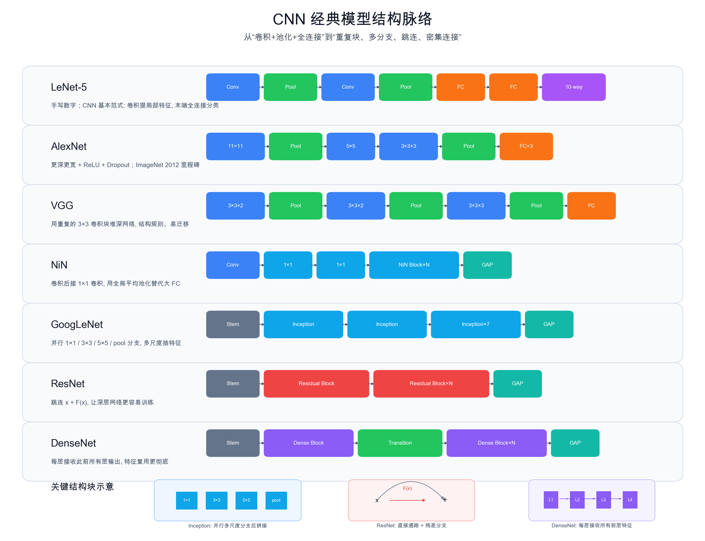

<!--# cnnmodels -->
# CNN 经典模型:从 LeNet 到 DenseNet

> 本篇不追求论文细节,先建立 CNN 架构演进的主线:LeNet 给出基本范式;AlexNet 证明深 CNN 在大规模视觉任务上的威力;VGG 用规则卷积块堆深;NiN 用 $1\times1$ 卷积和全局平均池化减少全连接依赖;GoogLeNet 用多分支 Inception;ResNet 用残差连接解决深层训练;DenseNet 进一步强化特征复用。

## 1. LeNet:卷积网络的基本范式

LeNet 面向手写数字识别,结构可以简化为:

$$
\text{Conv}\rightarrow \text{Pool}\rightarrow \text{Conv}\rightarrow \text{Pool}\rightarrow \text{FC}\rightarrow \text{Output}
$$

它确立了早期 CNN 的基本套路:

- 卷积层提取局部特征;
- 池化层降低空间分辨率;
- 后面用全连接层做分类。

从学习角度看,LeNet 是理解 CNN 的起点:先不急着看很深的网络,先把"卷积提特征 + 分类器输出类别"这件事吃透。

## 2. AlexNet:深度学习视觉爆发点

AlexNet 把 CNN 扩展到更大规模的 ImageNet 图像分类任务,结构比 LeNet 更深更宽:

$$
\text{Conv/Pool blocks}\rightarrow \text{FC layers}\rightarrow \text{softmax}
$$

它的重要性主要在工程和历史层面:

- 使用 ReLU,比 sigmoid / tanh 更适合训练深层网络;
- 使用 dropout 缓解全连接层过拟合;
- 在大数据和 GPU 训练条件下,证明深 CNN 可以大幅提升视觉分类效果。

如果 LeNet 说明"CNN 可以识别简单图像",AlexNet 则说明"CNN 可以扩展到真实大规模视觉任务"。

## 3. VGG:用规则小卷积核堆深网络

VGG 的特点是结构非常规整:反复使用 $3\times3$ 卷积,每若干个卷积后接池化:

$$
\text{VGG block}=(3\times3\ \text{Conv})\times n+\text{Pool}
$$

它的直觉是:多个小卷积核堆叠,可以获得更大的有效感受野,同时引入更多非线性。例如两个 $3\times3$ 卷积叠起来,有效感受野接近 $5\times5$,但参数更少、层间多一次激活。

VGG 很适合作为"卷积块"思想的入门:网络不再是一层一层零散设计,而是由重复模块组成。

## 4. NiN:用 $1\times1$ 卷积增强通道混合

NiN(Network in Network) 的核心是:在普通卷积之后接 $1\times1$ 卷积。$1\times1$ 卷积不看更大的空间窗口,但会在通道维度上做组合,相当于对每个空间位置做一个小型 MLP。

它还引入了一个重要方向:用**全局平均池化**替代大量全连接层。

$$
\text{feature maps}\rightarrow \text{global average pooling}\rightarrow \text{class scores}
$$

这样可以减少参数,也让类别输出更直接地对应到特征图响应。

## 5. GoogLeNet:Inception 多分支结构

GoogLeNet 的核心组件是 Inception block。它不是只选一种卷积核大小,而是在同一层里并行使用多种分支:

$$
1\times1,\quad 3\times3,\quad 5\times5,\quad \text{pool}
$$

然后把这些分支的输出在通道维度拼接起来。直觉是:同一层同时看不同尺度的局部模式,让网络自己组合多尺度特征。

Inception 里常用 $1\times1$ 卷积做降维,否则多分支会带来很大的计算量。它代表的设计思想是:不是简单加深或加宽,而是设计更高效的模块。

## 6. ResNet:残差连接让深层网络更容易训练

网络变深后,训练不一定更好。深层网络可能出现梯度传播困难、退化等问题。ResNet 的关键是残差块:

$$
\mathbf y=\mathbf x+F(\mathbf x)
$$

其中 $\mathbf x$ 是直接跳过若干层的输入,$F(\mathbf x)$ 是卷积分支学习到的残差。这样一来,模块不必从零学习完整映射,只要学习"在原输入基础上需要改什么"。

从直觉上看:

- 如果某些层暂时没学到有用东西,直接通路仍能把信息传下去;
- 梯度也可以沿跳连路径更顺畅地传回浅层;
- 因此网络可以堆得更深。

ResNet 是现代 CNN 中非常核心的一条思想线,也影响了后来的 Transformer 残差连接设计。

## 7. DenseNet:更彻底的特征复用

DenseNet 进一步强化连接方式:一个 dense block 中,每一层都会接收前面所有层的输出。

$$
\mathbf x_l=H_l([\mathbf x_0,\mathbf x_1,\ldots,\mathbf x_{l-1}])
$$

这里 $[\cdot]$ 表示在通道维度拼接。它的核心想法是:

- 浅层特征可以直接传到深层;
- 不同层学到的特征被反复复用;
- 梯度传播路径更多,训练更顺。

DenseNet 可以看作从 ResNet 的"相加跳连"走向"拼接式密集连接"。

## 8. 模型演进主线

把这些模型串起来,可以看到 CNN 结构演进并不是随机堆名字:

| 模型 | 解决的关键问题 | 结构关键词 |
|---|---|---|
| LeNet | CNN 基本图像分类流程 | Conv + Pool + FC |
| AlexNet | 大规模视觉任务上训练深 CNN | ReLU、Dropout、更深更宽 |
| VGG | 如何规则地加深网络 | 重复 $3\times3$ 卷积块 |
| NiN | 如何减少大 FC、增强通道组合 | $1\times1$ 卷积、全局平均池化 |
| GoogLeNet | 如何高效融合多尺度特征 | Inception 多分支 |
| ResNet | 很深网络如何训练 | 残差连接 |
| DenseNet | 如何更充分复用特征 | 密集连接 |

学习时建议先按下面顺序抓主线:

1. **LeNet**:明白 CNN 分类器长什么样;
2. **AlexNet / VGG**:明白加深网络和卷积块;
3. **NiN / GoogLeNet**:明白 $1\times1$ 卷积、多分支和全局平均池化;
4. **ResNet / DenseNet**:明白深层网络里的连接设计。

## 应掌握的要点

- 经典 CNN 模型的差别主要在结构模块,不是训练闭环;
- LeNet 是基本范式,AlexNet 是大规模视觉里程碑;
- VGG 用重复小卷积块建立规则深网络;
- NiN 强调 $1\times1$ 卷积和全局平均池化;
- GoogLeNet 用 Inception 并行多尺度分支;
- ResNet 用残差连接让深层训练更容易;
- DenseNet 用密集连接强化特征复用。

---
### 参考链接
- d2l:[第 7 章 现代卷积神经网络](https://zh.d2l.ai/chapter_convolutional-modern/index.html)
- Medium:[CNN 經典模型 LeNet, AlexNet, VGG, NiN](https://medium.com/ching-i/%E5%8D%B7%E7%A9%8D%E7%A5%9E%E7%B6%B2%E7%B5%A1-cnn-%E7%B6%93%E5%85%B8%E6%A8%A1%E5%9E%8B-lenet-alexnet-vgg-nin-with-pytorch-code-84462d6cf60c)
