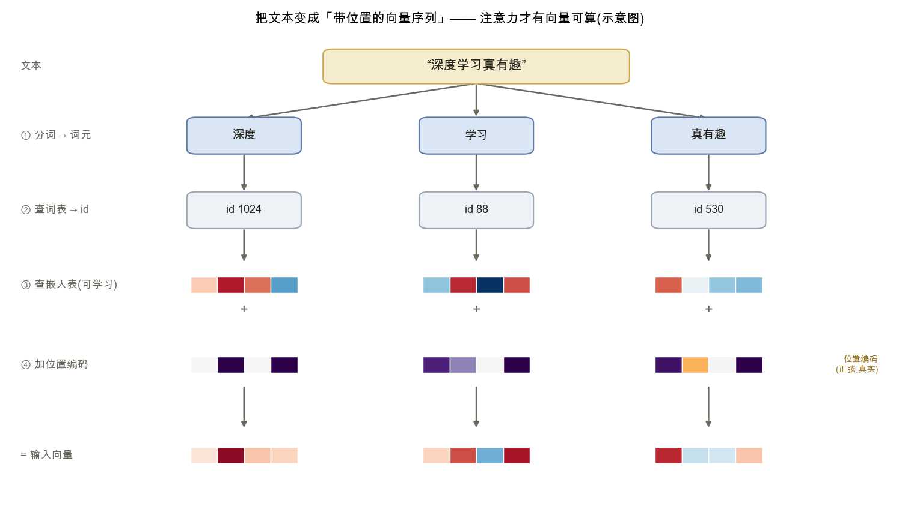
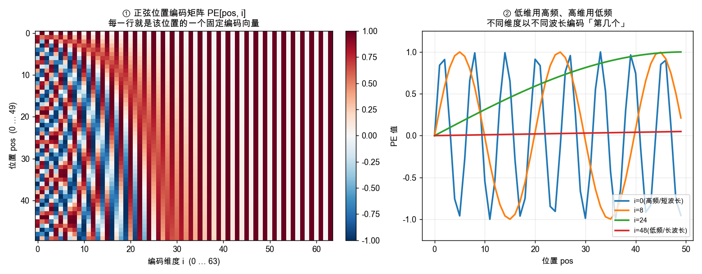

<!--# embed -->
# 输入表示:词元、嵌入与位置编码

> 父篇 [注意力 → Transformer](node:attn) 讲的注意力,算的是**向量之间**的关系:点积打分、softmax 加权。但语言不是向量,而是一串离散符号(字、词)。所以在注意力开始工作之前,必须先把一段文本变成一串**带位置的向量**。这一步分三小步:**分词**(把文本切成词元)、**嵌入**(把每个词元查成一个稠密向量)、**位置编码**(把"第几个"注入向量)。记号锚定 d2l 第 10–11 章。

## 1. 分词:把文本切成词元(token)

模型的词表(vocabulary)是有限的,而文本千变万化。**分词**把一段文本切成词表里的基本单位——**词元(token)**,再把每个词元映射成一个整数 **id**。

切分粒度有三种取舍:

- **字符级**:词表极小,但序列很长、单个字符语义弱;
- **词级**:语义完整,但词表巨大,且总会遇到没见过的词(未登录词,OOV);
- **子词级(subword)**:折中方案,把常见词整体保留、把罕见词拆成更小的部件。GPT 等模型采用的 **BPE(字节对编码)** 即属此类——从字符出发,反复把最高频的相邻对合并成新词元,直到词表达到设定大小。

子词级是现代语言模型的主流:词表可控,又几乎不会遇到完全无法表示的输入。本篇不展开 BPE 的合并算法,只需记住其结果:**一段文本 → 一串 token id**。

## 2. 嵌入:把词元 id 查成稠密向量

📌 **前置承接**:[线性代数 · 矩阵](node:linalg#矩阵) · [逻辑回归 / softmax 回归](node:softmax)

token id 只是个编号,本身没有语义距离(id 88 和 89 并不更相似)。要让模型能计算"词与词有多像",得把每个 id 换成一个**稠密向量**。

做法是准备一张**嵌入表(embedding matrix)** $E\in\mathbb R^{|V|\times d}$:词表有 $|V|$ 个词元,每个词元占表中一行,行长为嵌入维度 $d$(即 $d_{\text{model}}$)。"查表"就是取出第 id 行:
$$\mathbf e_{\text{id}}=E[\text{id}]=\text{one-hot}(\text{id})^{\top}E.$$
右边把它写成"one-hot 向量乘矩阵",正是 [线性代数 · 矩阵](node:linalg#矩阵) 里"矩阵乘法对行/列做选择与加权"的特例——查表只是一次特别简单的矩阵运算。

关键在于:**$E$ 的每个数都是可学习参数**。初始随机,训练中与其它参数一起被梯度下降更新,最终让语义相近的词元落在相近的向量位置。这就是把"离散符号"接进"连续可微网络"的入口。

## 3. 位置编码:把"第几个"注入向量

📌 **前置承接**:[注意力 → Transformer · 位置编码](node:attn#位置编码)

到这里,一段文本已变成一串词嵌入向量,但还差一样东西:**顺序**。父篇指出过,注意力本身是**无序**的——打乱输入顺序,输出只是跟着换位,词与词的关系不变。可是"猫追狗"和"狗追猫"语义截然不同。于是要显式地把**位置信息**加进每个向量。

最经典的是**正弦位置编码**:给位置 $pos$、维度按对编号 $k$,赋一组固定值
$$PE(pos,2k)=\sin\!\Big(\frac{pos}{10000^{2k/d}}\Big),\qquad PE(pos,2k+1)=\cos\!\Big(\frac{pos}{10000^{2k/d}}\Big).$$
每一对维度用一个频率:低维频率高(波长短)、高维频率低(波长长)。于是每个位置都得到一个**独一无二**的编码向量,且不同位置间的相对关系能被注意力线性地利用。

另一种常见做法是**可学习位置嵌入**:像词嵌入一样,再准备一张"位置 → 向量"的可学习表(GPT 系列即用此法)。两种方式都把位置变成一个与词嵌入同维的向量。

最后把它**加**到词嵌入上(不是拼接):
$$\mathbf x_{pos}=\mathbf e_{\text{id}(pos)}+PE(pos).$$
于是每个位置得到一个**既含语义、又含位置**的向量;整段文本成为一个形状为(序列长度 $\times\ d$)的矩阵,这才是送进 [掩码自注意力](node:masked) 的真正输入。

## 应掌握的要点

- 注意力算的是向量间关系,而语言是离散符号,故须先把"文本 → 带位置的向量序列";
- **分词**把文本切成词元(token)再映射成 id;子词(如 BPE)兼顾词表大小与未登录词,是主流;
- **嵌入**用一张可学习的表 $E$ 把 id 查成稠密向量,本质是 one-hot 乘矩阵;语义相近的词元被训练到相近位置;
- **位置编码**把顺序注入向量(因为注意力本身无序):正弦编码或可学习位置嵌入,**加**到词嵌入上;
- 三步合起来:输入 = 词嵌入 + 位置编码,形状(序列长度 $\times\ d$),送入掩码自注意力。

---
### 参考链接
- [d2l 10.6 自注意力与位置编码](https://zh.d2l.ai/chapter_attention-mechanisms/self-attention-and-positional-encoding.html)
- 本库内链:[注意力 → Transformer](node:attn) · [线性代数 · 矩阵](node:linalg#矩阵) · [逻辑回归 / softmax 回归](node:softmax) · [掩码自注意力](node:masked) · [语言建模](node:lm)
- 配图复现:[实验 · Transformer图示](node:lab)(`embed-pipeline.png` 为示意、`pos-encoding.png` 为真实计算)
