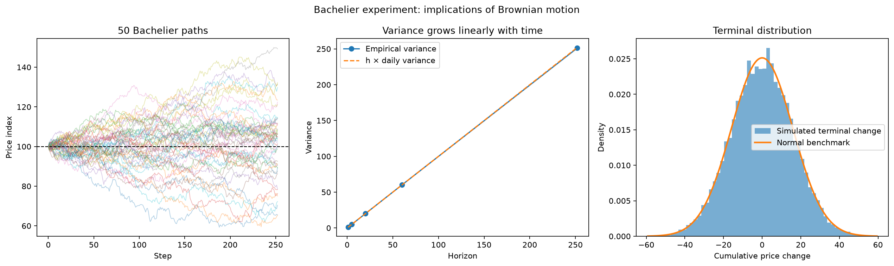

<!--# randomwalk -->
# 随机游走与布朗运动

## 先给结论

巴舍利耶的合理性不在于“真实股价严格服从正态随机游走”，而在于他给出了一个清晰、可计算、可证伪的**随机基准模型**：如果短期价格变化主要由不可预知的新信息驱动，那么下一步方向不应仅凭过去一步稳定预测，累计不确定性应随时间扩大。

因此，更准确的表述是：

> 布朗运动是研究价格变化的零假设和第一近似，不是对真实市场全部规律的最终描述。

## 从离散随机游走到布朗运动

设每一步价格变化为 $\varepsilon_t$，最简单的离散随机游走是：

$$X_n=X_0+\sum_{t=1}^{n}\varepsilon_t$$

若增量独立同分布，并满足：

$$E[\varepsilon_t]=0,\qquad \operatorname{Var}(\varepsilon_t)=\sigma^2$$

则：

$$E[X_n-X_0]=0$$

$$\operatorname{Var}(X_n-X_0)=n\sigma^2$$

第二条非常重要：时间扩大为原来的 $n$ 倍，方差扩大 $n$ 倍，标准差只扩大 $\sqrt{n}$ 倍。这就是常见“平方根时间缩放”的来源。

在连续时间极限下，可写成巴舍利耶式算术布朗运动：

$$S_t=S_0+\mu t+\sigma W_t$$

其中 $W_t$ 是标准布朗运动，满足：

- $W_0=0$；
- 不相交区间的增量相互独立；
- $W_{t+h}-W_t\sim N(0,h)$；
- 样本路径连续，但几乎处处不可微。

当 $\mu=0$ 时，未来价格变化的条件均值为零。加入漂移后，模型表达的是“在可估计的平均漂移之外，短期变化仍由随机增量主导”。

## 为什么这个模型有合理性

### 1. 新信息在到来前不可知

如果公开信息已经被交易者迅速反映到价格中，下一条真正的新信息就不能从旧价格中被确定性地推出。于是过去一次上涨本身不应保证下一次继续上涨。

这不是说所有市场都完全有效，而是提供一个严格的对照：任何声称能预测价格的规则，都应证明自己优于“下一步不可预测”这一基准，并通过样本外验证和交易成本检验。

### 2. 很多小冲击叠加会趋向稳定分布

一个交易周期内可能同时出现订单、新闻、流动性变化和投资者判断等大量冲击。如果这些冲击足够分散、没有单一因素长期支配，中心极限定理会使聚合变化接近正态分布。这解释了为什么高斯增量是自然的第一模型。

### 3. 模型给出明确、可检验的推论

布朗运动不仅说“价格很随机”，还给出可以验证的量化预测：

- 增量均值接近设定漂移；
- 相邻增量线性相关接近零；
- 上下方向在零漂移时接近各半；
- $h$ 期累计变化方差约为 $h\sigma^2$；
- 固定期限的累计变化服从正态分布。

能够被数据或实验推翻，是它比模糊的“市场不可预测”更有价值的原因。

## Python 实验：验证模型自身推论

实验固定随机种子 82，生成 20,000 条路径，每条 252 步，每步增量服从 $N(0,1)$。这不是用模拟“证明真实市场”，而是检查代码生成的过程是否符合理论。

核心结果：

| 指标 | 模拟结果 | 理论值 |
|---|---:|---:|
| 单步增量均值 | -0.000258 | 0 |
| 单步增量标准差 | 1.000393 | 1 |
| 相邻增量相关系数 | -0.000387 | 0 |
| 相邻两步同方向比例 | 49.9827% | 50% |
| 252 步累计变化为正的比例 | 50.2250% | 50% |
| 252 步累计变化标准差 | 15.8482 | $\sqrt{252}=15.8745$ |

方差时间缩放：

| 期限 $h$ | 模拟方差 | 理论方差 $h\sigma^2$ | 比值 |
|---:|---:|---:|---:|
| 1 | 0.9981 | 1 | 0.9981 |
| 5 | 5.0027 | 5 | 1.0005 |
| 20 | 19.9971 | 20 | 0.9999 |
| 60 | 60.0792 | 60 | 1.0013 |
| 252 | 251.1643 | 252 | 0.9967 |

实验支持的是：**独立高斯增量确实产生零相关、方向近似各半、方差随时间线性增长的过程。** 它没有检验真实股票是否满足这些假设，因为输入数据本来就是按模型生成的。

## 为什么真实市场不等于标准布朗运动

标准巴舍利耶模型至少有四个明显边界：

1. **价格可能为负**：算术布朗运动没有零下界，长期模拟可能产生负价格。现代入门模型常改用几何布朗运动：

   $$dS_t=\mu S_tdt+\sigma S_tdW_t$$

   它让对数价格服从带漂移的布朗运动，从而保持 $S_t>0$。

2. **正态分布低估极端变化**：真实收益通常具有尖峰、厚尾，极端涨跌比正态模型预期更常见。
3. **波动率并非常数**：大波动往往成簇出现。即使原始收益的线性自相关很低，收益平方或绝对值仍可能存在持续性。
4. **价格会跳跃且市场有微观结构**：公告、停牌、流动性枯竭、买卖价差和离散报价都会破坏连续路径假设。

因此，“收益方向难预测”与“市场没有任何可研究结构”不是同一句话。量化策略可以研究条件波动、横截面差异、风险溢价、执行成本和组合结构，但必须证明这些结构不是样本噪声。

## 对量化研究的实际意义

- 把随机游走当作**零假设**：策略首先应战胜随机或买入持有基准。
- 把低自相关当作提醒：单靠最近一次涨跌预测下一次涨跌通常证据不足。
- 把 $\sqrt{t}$ 缩放当作有条件公式：只有在独立、同分布和方差稳定等假设近似成立时才适用。
- 把模型残差当作研究对象：厚尾、波动聚集和跳跃意味着风险模型需要继续扩展。
- 不把回测盈利直接解释成可预测性：还要检查数据偏差、样本外表现和交易成本。

## 实验与资料

- [实验脚本](../../实验/scripts/task2_theory_origins.py)
- [实验报告](../../实验/reports/Task2-理论原点实验.md)
- [Bachelier（1900）：Théorie de la spéculation](https://archive.numdam.org/articles/10.24033/asens.476/)
- [Mandelbrot（1963）：The Variation of Certain Speculative Prices](https://users.math.yale.edu/mandelbrot/web_pdfs/033certainSpeculativePrices.pdf)
- [Cont（2001）：Empirical Properties of Asset Returns](https://doi.org/10.1080/713665670)
