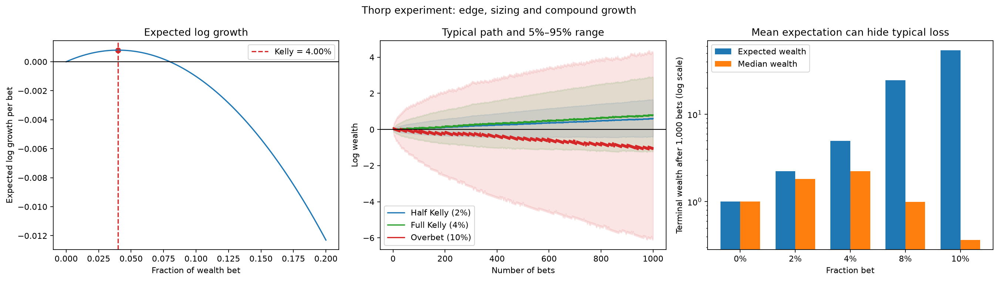

<!--# kellyposition -->
# 概率优势、复利与凯利仓位

## 先校正一句话

“概率优势 + 合理仓位管理，就能长期稳定盈利”抓住了索普思想的方向，但“稳定盈利”容易造成误解。更准确的表述是：

> 在概率、赔率和重复下注等假设稳定且估计正确时，正优势配合适当仓位可以产生正的长期期望对数增长；它不保证每一期盈利，也不保证没有深度回撤。

仓位公式最初来自 Kelly 1956 年的论文；索普把这一思想用于二十一点和资本市场，使“先确认优势，再决定下注规模”成为量化实践的重要范式。

## 二项下注模型

设：

- 当前财富为 $W$；
- 每次投入财富比例 $f$，且 $0\le f<1$；
- 获胜概率为 $p$，失败概率为 $q=1-p$；
- 每投入 1 单位，赢时获得净利润 $b$，输时损失投入金额。

下一期财富为：

$$W'=\begin{cases}
W(1+bf), & \text{win}\\
W(1-f), & \text{loss}
\end{cases}$$

每次下注的财富算术期望增长率为：

$$\frac{E[W'-W]}{W}=f(bp-q)$$

因此，游戏存在正优势的条件是：

$$bp-q>0$$

如果是等额赔率 $b=1$，条件就是 $p>0.5$。

## 为什么只看财富期望不够

财富经过多次下注是乘法过程：

$$W_n=W_0\prod_{t=1}^{n}(1+R_t)$$

算术期望可能被少数极端幸运路径拉高，不能代表大多数参与者的典型结果。仓位过大时，偶尔暴富的路径可以让平均财富很高，同时多数路径却低于本金。

对数把乘法转成加法：

$$\log\frac{W_n}{W_0}=\sum_{t=1}^{n}\log(1+R_t)$$

因此长期复利更自然的目标是最大化每次下注的期望对数增长：

$$g(f)=p\log(1+bf)+q\log(1-f)$$

对 $f$ 求导：

$$g'(f)=\frac{pb}{1+bf}-\frac{q}{1-f}$$

令 $g'(f)=0$，得到凯利比例：

$$f^*=\frac{bp-q}{b}=p-\frac{q}{b}$$

并且：

$$g''(f)=-\frac{pb^2}{(1+bf)^2}-\frac{q}{(1-f)^2}<0$$

所以 $f^*$ 是唯一最大值，而不是任意驻点。

## 52% 胜率为什么对应 4% 仓位

实验设置等额赔率 $b=1$、胜率 $p=0.52$，则：

$$q=0.48,\qquad f^*=0.52-0.48=0.04$$

也就是每次投入当前财富的 4%。对应的理论期望对数增长率为：

$$g(0.04)=0.52\log(1.04)+0.48\log(0.96)\approx0.000800$$

如果胜率实际只有 50%，同样下注 4%：

$$g(0.04)=0.5\log(1.04)+0.5\log(0.96)\approx-0.000801$$

这说明**仓位管理不能创造优势**。没有优势时，波动拖累会使任何非零固定比例下注的期望对数增长为负；仓位只能把已有优势转化为资金增长，并控制优势判断错误时的损失速度。

## 为什么凯利逻辑成立

### 1. 对数增长对应长期复利

在独立同分布、参数稳定的假设下，大数定律使单位次数的实际对数增长趋近 $g(f)$：

$$\frac{1}{n}\log\frac{W_n}{W_0}\longrightarrow g(f)$$

若 $g(f)>0$，典型财富路径长期呈指数增长；若 $g(f)<0$，典型路径长期衰减。

### 2. 固定比例会随财富自动调整风险

盈利后下注金额增加，亏损后下注金额减少，避免用固定金额让风险相对财富失控。只要 $f<1$，一次失败不会把财富直接降为零。

### 3. 它明确揭示“过度下注”

正优势不意味着仓位越大越好。超过凯利比例后，期望对数增长下降；继续加仓会跨过 $g(f)=0$，让典型路径从增长转为衰减。

## Python 实验：优势相同，只改变仓位

实验固定胜率 52%、等额赔率、初始财富 1，重复下注 1,000 次，并模拟 50,000 个终值。不同策略始终面对同一个概率优势，只改变每次投入比例。

| 策略 | 仓位 | 每次期望对数增长 | 理论期望财富 | 模拟中位财富 | 5% 分位财富 | 低于本金概率 |
|---|---:|---:|---:|---:|---:|---:|
| 不下注 | 0% | 0 | 1.000 | 1.000 | 1.000 | 0.00% |
| 半凯利 | 2% | 0.000600 | 2.225 | 1.822 | 0.644 | 18.02% |
| 全凯利 | 4% | 0.000800 | 4.947 | 2.226 | 0.278 | 27.64% |
| 双倍凯利 | 8% | -0.000003 | 24.408 | 0.997 | 0.015 | 51.72% |
| 过度下注 | 10% | -0.001012 | 54.164 | 0.364 | 0.002 | 63.99% |

结果揭示了四件事：

1. **全凯利最大化长期增长率**：4% 的理论 $g(f)$ 在所有候选仓位中最高。
2. **最大增长不等于最平稳**：全凯利的中位财富高于半凯利，但左尾更深，有限 1,000 次后低于本金的概率也更高。
3. **双倍凯利接近增长边界**：8% 仓位的期望对数增长约为零，中位财富几乎回到初始值。
4. **算术平均会掩盖典型亏损**：10% 仓位的理论期望财富高达 54.164，但中位财富只有 0.364，约 64% 的路径低于本金。少数极端幸运路径抬高了平均数。

这正是索普思想的核心：**先确认优势，再以复利目标选择仓位；只确认“期望收益为正”却忽略下注比例，仍可能长期亏损。**

## 为什么实务中常用半凯利或更低

简单公式假设 $p$、$b$ 已知且长期不变，但金融市场中的优势通常来自历史估计：

- 胜率和盈亏比存在估计误差；
- 收益不是只有赢/输两个结果；
- 交易机会并非独立，相关性会同时放大多个头寸；
- 市场状态、成本、滑点和容量会变化；
- 杠杆、保证金和最大回撤约束会提前终止策略。

如果高估了 $p$ 或低估了损失幅度，计算出的凯利仓位会系统性过大。分数凯利把仓位设为 $c f^*$，其中 $0<c<1$。它牺牲部分理论增长率，换取更浅的回撤、对参数误差更强的容忍度和更高的执行可持续性。

在多资产情形下，简单二项公式不再直接适用，目标可推广为：

$$\max_{\boldsymbol{w}}E\left[\log\left(1+\boldsymbol{w}^{\mathsf{T}}\boldsymbol{R}\right)\right]$$

同时加入杠杆、单资产上限、组合相关性、流动性和回撤约束。实际项目中，凯利更适合用作**仓位上限与敏感性分析工具**，而不是机械执行的唯一答案。

## 对量化研究的实际意义

- 没有经过样本外验证和成本检验的“优势”，不应进入仓位公式。
- 正期望回答“值不值得做”，仓位管理回答“做多大”。
- 平均终值不能代替中位数、分位数、亏损概率和[最大回撤](node:drawdownposition)。
- 优势越不确定、相关性越高、尾部越厚，实际仓位越应低于理论凯利。
- 凯利结论是条件命题，不是盈利承诺，更不是投资建议。

## 实验与资料

- [实验脚本](../../实验/scripts/task2_theory_origins.py)
- [实验报告](../../实验/reports/Task2-理论原点实验.md)
- [Kelly（1956）：A New Interpretation of Information Rate](https://doi.org/10.1002/j.1538-7305.1956.tb03809.x)
- [Rotando 与 Thorp：The Kelly Criterion and the Stock Market](https://www.edwardothorp.com/wp-content/uploads/2016/11/TheKellyCriterionAndTheStockMarket.pdf)
